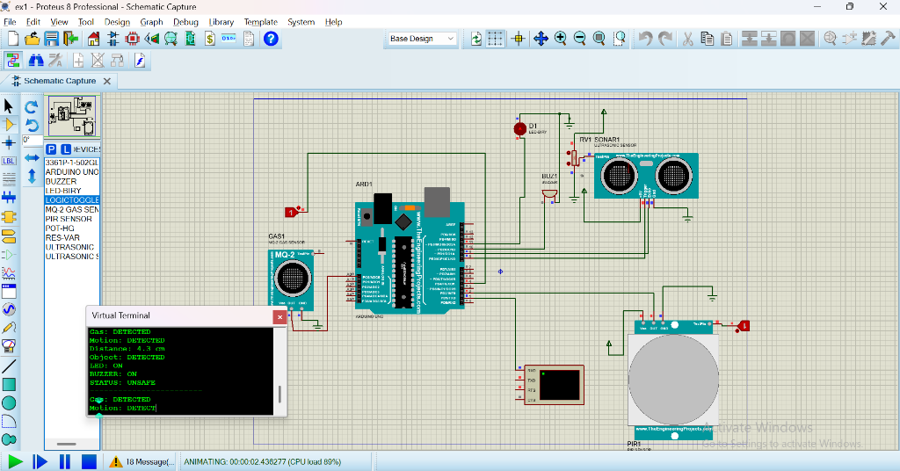

# Experiment 1: Smart Home Safety System

## Overview
This experiment implements a **Smart Home Safety System** using an Arduino Uno microcontroller. It interfaces multiple sensors to detect environmental hazards, movement, and nearby obstacles, triggering audio-visual alerts (Buzzer & LED) and outputting status reports via the Serial Virtual Terminal.

---

## Components Used
- **Microcontroller**: Arduino Uno (ATmega328P)
- **Gas Sensor**: MQ-2 Gas Sensor
- **Motion Sensor**: PIR Motion Sensor
- **Distance Sensor**: Ultrasonic Sensor (HC-SR04) with Potentiometer (RV1) for simulation
- **Indicators**:
  - Red LED (`D1`)
  - Buzzer (`BUZ1`)
- **Virtual Terminal**: Proteus Serial Terminal for real-time monitoring
- **Logic Toggles**: For simulating digital inputs in Proteus

---

## Pin Connections

| Component / Function | Arduino Uno Pin | Type | Description |
|----------------------|-----------------|------|-------------|
| **PIR Motion Sensor** | Pin 2 (`D2`) | Input | High when motion detected |
| **MQ-2 Gas Sensor** | Pin 4 (`D4`) | Input | High when gas detected |
| **Ultrasonic Trigger** | Pin 8 (`D8`) | Output | 10µs pulse to initiate measurement |
| **Ultrasonic Echo** | Pin 9 (`D9`) | Input | Echo pulse width proportional to distance |
| **Buzzer** | Pin 10 (`D10`) | Output | Sounds alarm on any hazard detected |
| **LED** | Pin 11 (`D11`) | Output | Lights up on any hazard detected |
| **Virtual Terminal RX** | Pin 1 (`TX`) | Communication | Serial debug log at 9600 baud |

---

## Working Principle
1. The Arduino continuously samples the **MQ-2 Gas Sensor** (Pin 4) and **PIR Motion Sensor** (Pin 2).
2. It sends a 10 µs pulse through the **Trigger pin** (Pin 8) and measures the return pulse on the **Echo pin** (Pin 9) using `pulseIn()`. The distance is calculated using the formula:
   $$\text{Distance (cm)} = \frac{\text{duration} \times 0.0343}{2}$$
3. An object is considered detected if the measured distance is $\le 100\text{ cm}$.
4. If **any** hazard is detected (Gas detected OR Motion detected OR Object $\le 100\text{ cm}$):
   - The **LED** turns ON.
   - The **Buzzer** sounds an alarm.
   - The system status transitions to `UNSAFE`.
5. The Virtual Terminal displays formatted status reports every 500 ms.

---

## Proteus Simulation Screenshot

---

## Files in this Folder
- `ex1.pdsprj`: Proteus 8 Professional schematic project file
- `sketch_oct23a.ino`: Arduino C++ source code
- `sketch_oct23a.ino.hex`: Compiled Arduino binary (hex) for Proteus simulation
- `screenshot.png`: Captured simulation schematic and Virtual Terminal output
