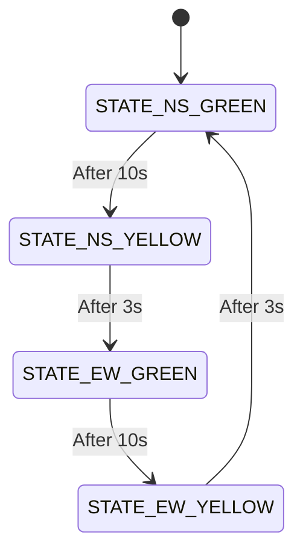
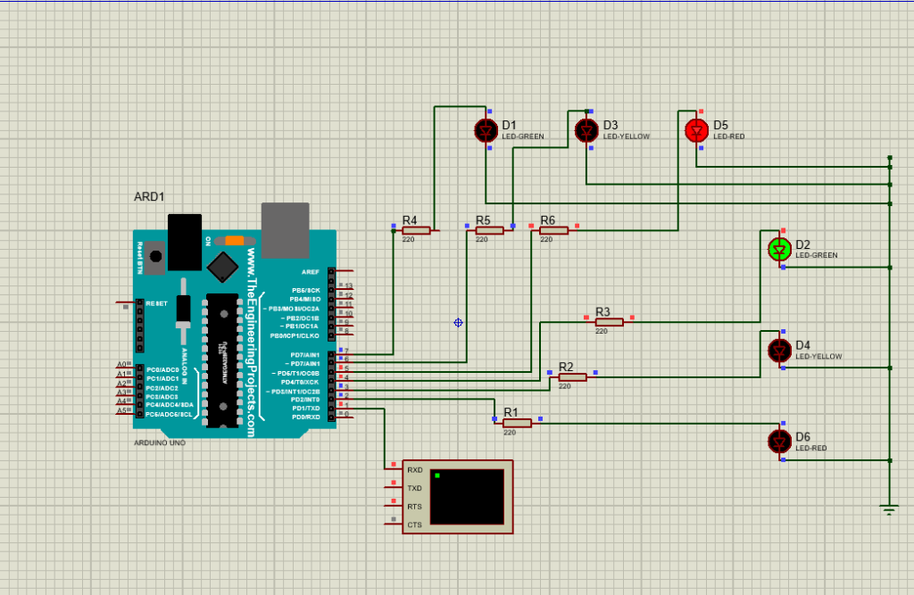
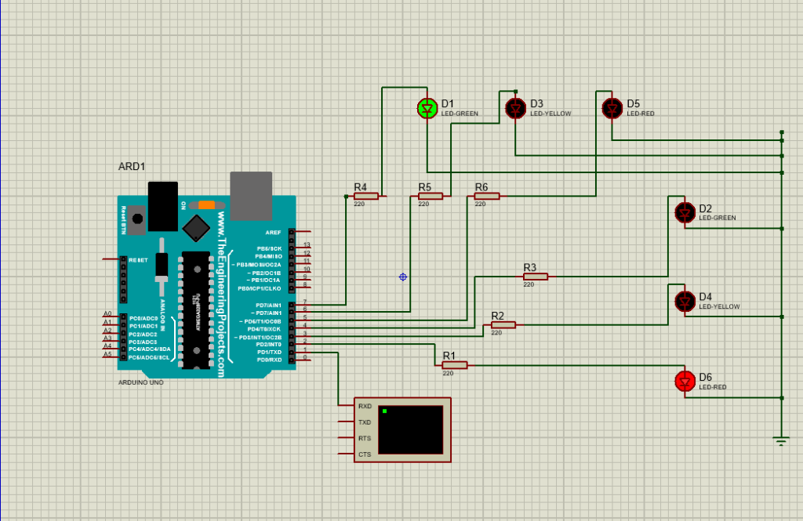

# Experiment 2: Formal Design of Embedded Controller Using FSM (Traffic Light Controller)

## Overview
This experiment demonstrates the **formal design of an embedded controller using a Finite State Machine (FSM)**. A 4-phase traffic light controller for an intersection (North-South and East-West directions) is modeled and implemented on an **Arduino Uno** and simulated in **Proteus 8 Professional**.

---

## FSM State Model

The traffic light controller cycles through 4 sequential states to ensure conflict-free traffic flow:

### State Transition Table

| State | State Name | NS Signal (D6 / D4 / D2) | EW Signal (D5 / D3 / D1) | Duration | Serial Monitor Log |
|:---:|:---|:---:|:---:|:---:|:---|
| **S0** | `STATE_NS_GREEN` | **GREEN** (Pin 4) | **RED** (Pin 5) | 10 sec | `STATE S0: NS GREEN - EW RED` |
| **S1** | `STATE_NS_YELLOW` | **YELLOW** (Pin 3) | **RED** (Pin 5) | 3 sec | `STATE S1: NS YELLOW - EW RED` |
| **S2** | `STATE_EW_GREEN` | **RED** (Pin 2) | **GREEN** (Pin 7) | 10 sec | `STATE S2: NS RED - EW GREEN` |
| **S3** | `STATE_EW_YELLOW` | **RED** (Pin 2) | **YELLOW** (Pin 6) | 3 sec | `STATE S3: NS RED - EW YELLOW` |

---

## Circuit Components & Pinout

| Direction | Signal Color | Proteus Component | Arduino Pin | Resistor |
|-----------|--------------|-------------------|-------------|----------|
| **North-South (NS)** | Green | `D2` (LED-GREEN) | Pin 4 (`D4`) | 220 $\Omega$ (`R3`) |
| **North-South (NS)** | Yellow | `D4` (LED-YELLOW) | Pin 3 (`D3`) | 220 $\Omega$ (`R2`) |
| **North-South (NS)** | Red | `D6` (LED-RED) | Pin 2 (`D2`) | 220 $\Omega$ (`R1`) |
| **East-West (EW)** | Green | `D1` (LED-GREEN) | Pin 7 (`D7`) | 220 $\Omega$ (`R4`) |
| **East-West (EW)** | Yellow | `D3` (LED-YELLOW) | Pin 6 (`D6`) | 220 $\Omega$ (`R5`) |
| **East-West (EW)** | Red | `D5` (LED-RED) | Pin 5 (`D5`) | 220 $\Omega$ (`R6`) |

---

## Proteus Simulation Screenshots

### State S0: North-South Green & East-West Red

### State S2: East-West Green & North-South Red

---

## Files in this Folder
- `ex2.pdsprj`: Proteus 8 Professional schematic project file
- `sketch_oct22a.ino`: Arduino C++ FSM source code
- `sketch_oct22a.ino.hex`: Compiled Arduino binary (hex) for Proteus simulation
- `screenshot_ns_green_ew_red.png`: Screenshot of State S0 simulation
- `screenshot_ew_green_ns_red.png`: Screenshot of State S2 simulation
