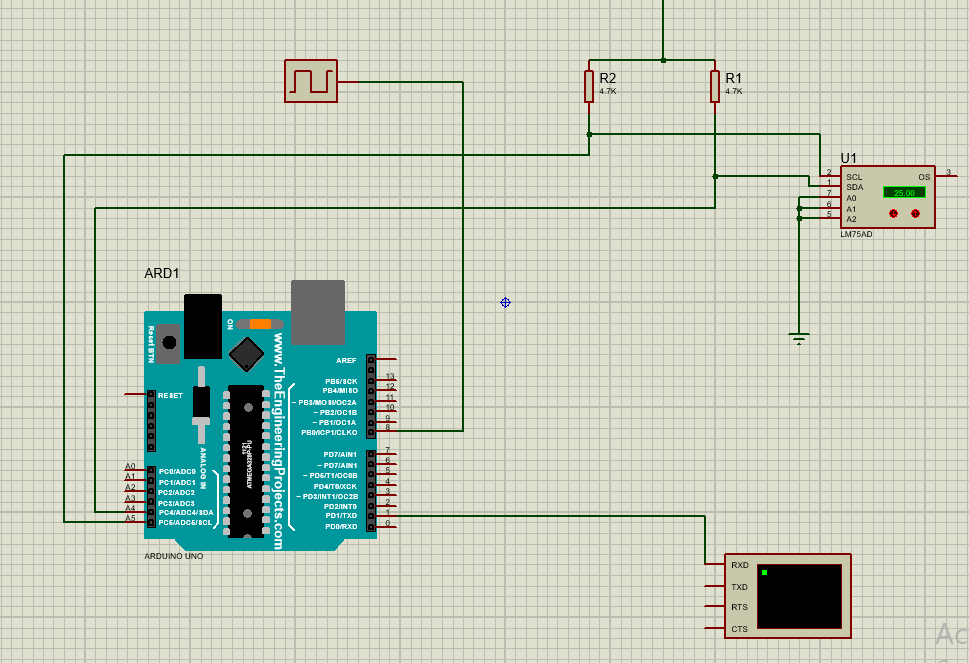
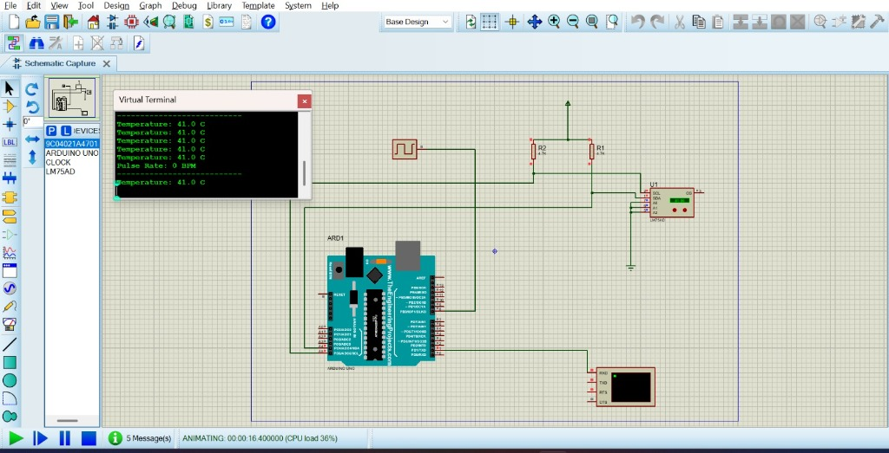

# Experiment 3: Temperature Monitoring and Fan Control

## Overview
This experiment implements temperature sensing and automated fan control using an Arduino Uno microcontroller with a digital/analog temperature sensor and timer interrupts.

## Proteus Simulation Screenshots

## Files Included
- `ex3.pdsprj`: Proteus 8 Professional schematic
- `sketch_oct22a.ino`: Arduino C++ code
- `sketch_oct22a.ino.hex`: Compiled hex binary for Proteus
- `screenshot_circuit.png`: Proteus schematic view
- `screenshot_simulation.jpg`: Simulation with Virtual Terminal output
