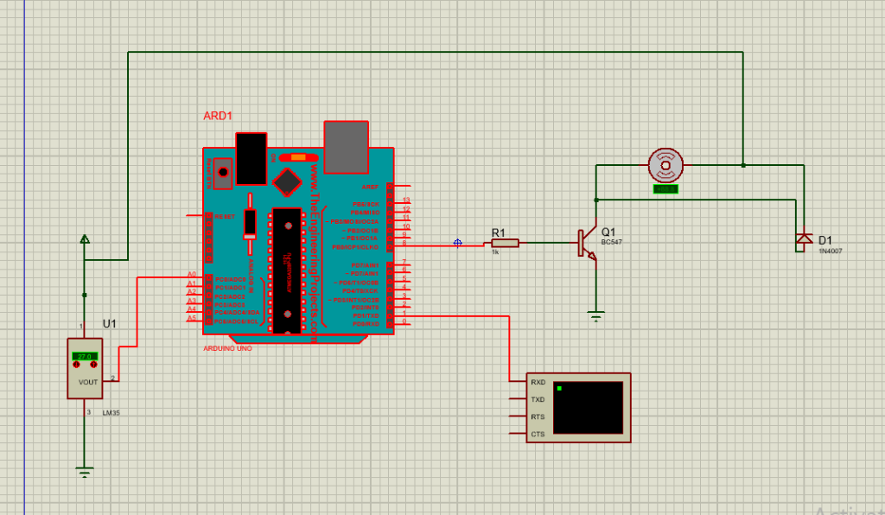
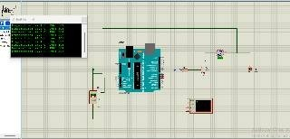

# Experiment 4: Temperature-Controlled DC Fan Using Timer Interrupts and PWM

## Overview
This experiment implements a **temperature-controlled DC motor/fan speed controller** using an **Arduino Uno**, an **LM35 analog temperature sensor**, a **BC547 driver transistor**, and **Timer1 interrupt-based software PWM**.

---

## Circuit Components & Connections
- **Microcontroller**: Arduino Uno (ATmega328P)
- **Temperature Sensor**: LM35 (VOUT connected to Analog Pin `A0`)
- **Driver**: BC547 NPN Transistor with $1\,\text{k}\Omega$ base resistor (`R1`) from Pin 8
- **Actuator**: DC Motor / Fan connected to transistor collector
- **Protection**: 1N4007 flyback diode across motor terminals
- **Output Monitor**: Proteus Virtual Terminal on TX pin

---

## Temperature to PWM Control Logic
- $T < 25^\circ\text{C}$: Fan OFF (PWM = 0%)
- $25^\circ\text{C} \le T < 30^\circ\text{C}$: Low Speed (PWM = 30%)
- $30^\circ\text{C} \le T < 35^\circ\text{C}$: Medium Speed (PWM = 60%)
- $T \ge 35^\circ\text{C}$: High Speed (PWM = 90%)

---

## Proteus Simulation Screenshots
### Schematic Capture

### Simulation Execution & Virtual Terminal Output

---

## Files in this Folder
- `ex4.pdsprj`: Proteus 8 Professional schematic project file
- `sketch_oct22a.ino`: Arduino C++ source code with Timer1 ISR PWM
- `sketch_oct22a.ino.hex`: Compiled Arduino binary (hex) for Proteus simulation
- `screenshot_circuit.png`: High-resolution circuit schematic
- `screenshot_simulation.jpg`: Simulation with Virtual Terminal readings
